# discfw: open firmware for the FiiO Snowsky Disc

> [!WARNING]
> **Experimental.** discfw is a hobby project in early development. It can have bugs that stop playback, drain the battery or need a reflash. You can always go back to FiiO's stock firmware over USB (see [Back to stock](#back-to-stock)). Use it at your own risk. This project is not made, supported or endorsed by FiiO.

discfw replaces the software of the [FiiO Snowsky Disc](https://www.fiio.com/) music player with an open system built from source with [Buildroot](https://buildroot.org/). It changes only one part of the player's flash memory: the root file system (`mtd2`). FiiO's boot loader, FiiO's Linux 4.4 kernel and the recovery system stay as they are.

What you get today:

- Music playback with [MPD](https://www.musicpd.org/) to the player's two CS43131 DACs, gapless, PCM up to 384 kHz.
- A new touch UI ([LVGL](https://lvgl.io/)): folders, queue, playlists, library, now playing, lock screen, settings.
- Bluetooth headphones (A2DP: SBC, aptX, aptX HD) with their battery level and buttons (play, pause, next, previous).
- USB storage mode and USB DAC mode, S/PDIF output on the 3.5 mm jack.
- Wi-Fi with SSH/SFTP and MPD over the network, so any MPD app can control the player.
- Equalizer: AutoEQ presets from the card, a 10-band graphic EQ and a parametric editor, a preset per output and per Bluetooth headset.
- Battery indicator, charge limit, low-battery power-off, sleep timer, configurable buttons.

| | | |
|:---:|:---:|:---:|
| 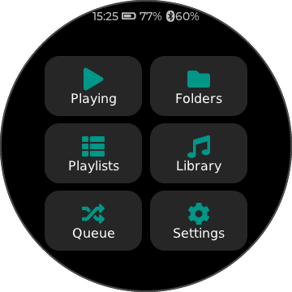 | 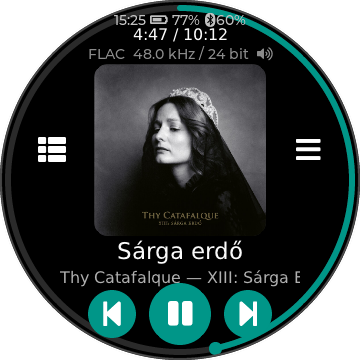 | 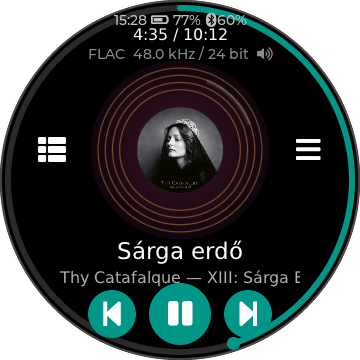 |
| Home | Now playing | Now playing, vinyl cover |
| 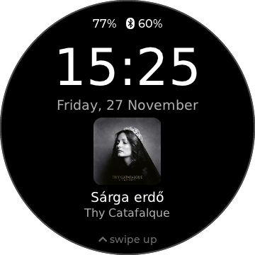 | 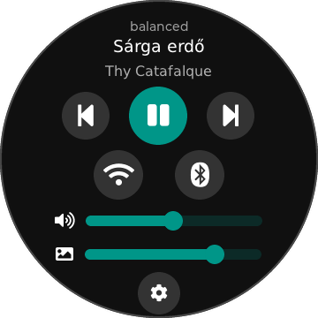 | 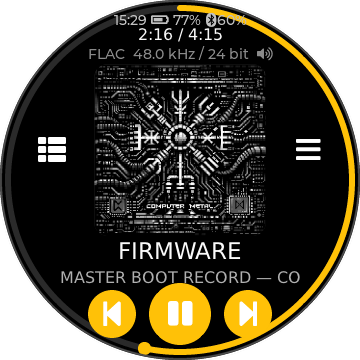 |
| Lock screen | Quick controls (swipe down) | Accent color |
| 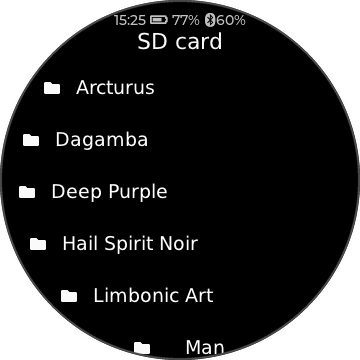 | 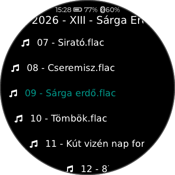 | 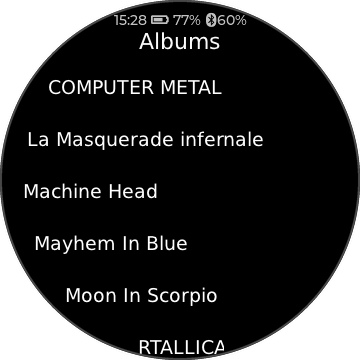 |
| Folders | Album folder | Library: albums |
| 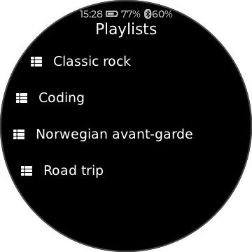 | 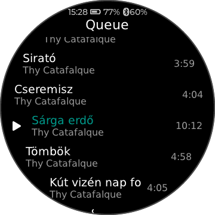 | 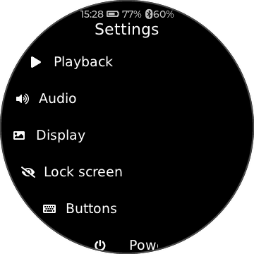 |
| Playlists | Queue | Settings |
| 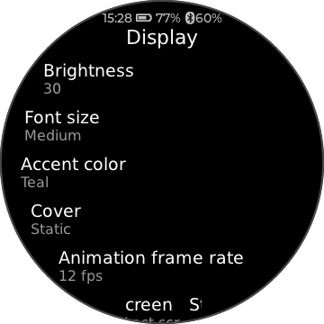 | 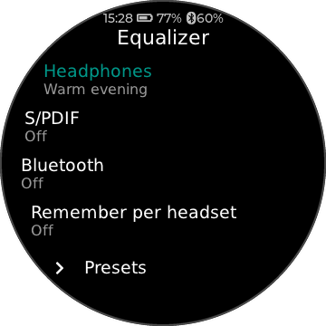 | 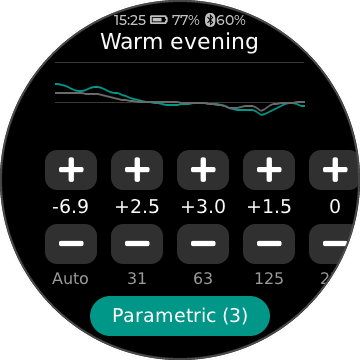 |
| Display settings | Equalizer per output | Equalizer editor |

## Goals

1. **Speed.** Short delay before a track starts and on skip. The stock player has a retry loop with 1-second sleeps on track changes and powers the DAC down on pause. discfw keeps the DAC ready: a skip takes about 30–50 ms at the same sample rate and about 300 ms when the rate changes.
2. **Functionality.** Everything the player needs every day, without the stock software. Because the whole user space is open, the player can do much more than the stock software allows: for example streaming audio over the network (RTP), more Bluetooth codecs (such as AAC or LDAC), other MPD plugins, or your own scripts and services.
3. **UX.** A UI made for the round screen, fast lists, clear settings.
4. **Easy to tinker with.** All source is here. Root shell over USB, SSH, plain shell scripts, a host build with fake hardware, test scripts that run on the player.
5. **Later: the newest mainline Linux kernel.** A port to Linux 7.4 works but is parked: [docs/MAINLINE.md](docs/MAINLINE.md).

## Status

Works: everything in the list above. See [docs/USAGE.md](docs/USAGE.md) for details.

Not yet: Bluetooth receiver mode, IPv6. The music card is read-only on the player. The clock comes from the network (NTP) because the stock kernel does not run the RTC. Some settings in the UI do nothing yet (list in [docs/USAGE.md](docs/USAGE.md#settings)).

## Hardware

| Part | What |
|---|---|
| SoC | Ingenic X2000 (XBurst II, MIPS32), 2 CPU threads at 1.2 GHz, FPU |
| RAM | 128 MiB LPDDR3 (117.5 MiB usable) |
| Flash | 256 MiB SPI NAND |
| Screen | 360×360 round, ST77916 over MIPI DSI; CST816T touch |
| Audio | 2× Cirrus CS43131 DAC (one per channel), 3.5 mm and 4.4 mm balanced outputs |
| Radio | AP6212 (Broadcom BCM43438): Wi-Fi 2.4 GHz, Bluetooth |
| Power | SGM41513 charger, CW2217 fuel gauge, AW35615 USB-C controller |
| Other | microSD slot, USB-C, 4 buttons (power, volume up, volume down, play) |

Details, pins and the flash layout: [docs/HARDWARE.md](docs/HARDWARE.md).

## How it works

Boot: the SoC's mask ROM starts FiiO's boot loader (`mtd0`). It loads FiiO's kernel (`mtd1`), which mounts the discfw root file system (`mtd2`, read-only squashfs) and runs `/linuxrc`, then BusyBox init. Settings and other state live in `/usr/data/discfw` on the stock data partition (`mtd7`). Music lives on the microSD card.

```
 buttons ──► discsys ◄────────────── discui ◄── touch
             keys, screen, power,    LVGL UI on /dev/fb0
             settings, Wi-Fi, BT         │
                 │ volume                │ MPD protocol
                 ▼                       ▼
              discd ◄── libdisc_hook ◄── MPD ◄── music on microSD
              DAC, charger               │
                 │ ioctl, I2C            │ PCM over I2S
                 ▼                       ▼
              stock kernel drivers ──► 2× CS43131 DAC ──► headphones
```

- **MPD** plays the music. Its ALSA output goes through `libdisc_hook`, which tells `discd` the sample rate and when to unmute and mute.
- **discd** drives the DAC through the stock kernel's driver and controls charging.
- **discsys** is the system policy: buttons, screen timeouts, power profiles, settings, Wi-Fi, Bluetooth, volume.
- **discui** is the UI. It talks to MPD and discsys. If it crashes, it restarts alone, and buttons keep working.
- The stock kernel stays, so discfw uses 8 kernel modules and radio firmware from FiiO's official update file. The build downloads that file itself (see [Blobs and stock firmware](#blobs-and-stock-firmware)).

More: [docs/DEVELOPMENT.md](docs/DEVELOPMENT.md) (design and dev tools), [docs/STOCK_KERNEL.md](docs/STOCK_KERNEL.md) (the kernel interfaces discfw uses and their quirks).

## Before you start

- **The player must run stock firmware V2.57.** The flasher checks this on the device and writes nothing on any other version. If your player runs an older version, update it first with FiiO's normal update.
- A Linux PC, x86_64, with about 11 GB of free disk space.
- A USB-C data cable.
- These packages: the [Buildroot host tools](https://buildroot.org/downloads/manual/manual.html#requirement-mandatory), host gcc 10 or newer, `curl`, Python 3.9 or newer with `venv`, `libusb-1.0`, and the static C library (needed to build the USB flasher tool). On Debian or Ubuntu:

```
sudo apt install build-essential bc bzip2 cpio curl file git libusb-1.0-0 patch perl python3 python3-venv rsync unzip wget xz-utils
```

On Fedora add `glibc-static`, on openSUSE add `glibc-devel-static`.

## Build

```
git clone https://github.com/olegantonyan/discfw.git
cd discfw
make
```

The first build takes about an hour on a fast PC. `make` downloads everything it needs:

| Input | From |
|---|---|
| Buildroot 2026.02.3 | buildroot.org |
| Source of all packages (MPD, BlueZ, LVGL, …) | their upstream sites, through Buildroot |
| FiiO V2.57 update file (105 MB) | `fiio-firmware.fiio.net`, decrypted during the build |

The results are in `output/images/`:

- `disc-rootfs-96M.bin`: the discfw image to flash.
- `stock-rootfs-v257-96M.bin`: FiiO's stock root file system, for the way back.
- `rootfs.squashfs`, `xImage-stock-v257` (FiiO's kernel, not flashed), `sha256sums.txt`.

Other targets: `make menuconfig`, `make savedefconfig`, `make br-<target>` (for example `make br-discui-rebuild`).

## Flash

Flashing uses the mask-ROM USB mode of the SoC and the flasher of the [diskOS](https://github.com/b0hemia/diskOS) project. `scripts/disc-flash` downloads a fixed diskOS version into `dl/`, sets up its Python packages in a venv and builds its `usbboot` tool. You do not need to install diskOS.

1. Check everything without the player:

```
scripts/disc-flash check
```

2. The first time, it asks you to install a udev rule, so that your user can access the player in mask-ROM mode:

```
sudo install -m 0644 dl/diskOS-*/udev/70-diskos-maskrom.rules /etc/udev/rules.d/ && sudo udevadm control --reload-rules && sudo udevadm trigger
```

3. Start the flash:

```
scripts/disc-flash rootfs
```

4. Put the player into **mask-ROM mode**: turn it off, hold **Volume Down**, plug in the USB cable, release after 3 seconds. The screen stays black.
5. Type `flash`. Writing takes about 18 minutes. Do not unplug the cable.
6. When it says `flashed`, unplug the cable and hold **Power** for about 6 seconds. The player starts discfw.

What the flasher does: before it writes, the device checks that the kernel and the recovery system are FiiO V2.57. Then it writes only `mtd2`, skips bad blocks and reads every block back. It never writes the boot loader, the kernel, the recovery system, the `mac` partition or your data partition.

If a flash fails, read the message. If the result is unknown, the player may still be writing: leave it connected for 25 minutes. Every new attempt needs a full power-off and a new start in mask-ROM mode. Mask-ROM mode is in the SoC itself, so it always works, whatever is in the flash.

## Back to stock

```
scripts/disc-flash stock
```

Then the same steps 4–6. This writes FiiO's original V2.57 root file system from `output/images/stock-rootfs-v257-96M.bin`. Your stock settings in the data partition stay. discfw's own folder `/usr/data/discfw` stays too; stock ignores it.

## First steps

- **Music:** put music files on a microSD card (exFAT or FAT32) with a card reader. discfw adds a new card to its library by itself; folders play at once, even before the scan ends.
- **Wi-Fi:** on the player, open Settings → Wi-Fi → Networks, pick your network and type the password. The Wi-Fi status page shows the IP address and the host name (`snowsky-disk-XXXX`).
- **SSH:** connect the player to the PC with USB and run `scripts/disc-ssh-key` once. It copies your public key over the USB shell. Then use `ssh -4 root@snowsky-disk-XXXX.local`. Password login is off.
- **MPD apps:** any MPD client can connect to port 6600 of the player.
- **USB root shell:** `scripts/disc-sh` (your user needs access to serial ports, often the `dialout` or `uucp` group).

All commands, settings and features: [docs/USAGE.md](docs/USAGE.md).

## Blobs and stock firmware

discfw is built from source, except these parts from FiiO:

- **On the player, never written by discfw:** the boot loader (`mtd0`), FiiO's Linux 4.4.94 kernel (`mtd1`), the recovery system (`mtd3`, `mtd4`).
- **From FiiO's official V2.57 update file, downloaded during the build:** 8 kernel modules for the stock kernel (SD card, Wi-Fi, GPIO, ADC, watchdog and helpers), the Broadcom Wi-Fi firmware and board calibration, and the Bluetooth patch file.

The kernel and the modules are GPL, but FiiO has not published their source [yet](https://www.head-fi.org/threads/echoes-of-time-snowsky-disc-pure-audio-player-is-officially-released.979352/page-22#post-19294162). The radio firmware is proprietary Broadcom code. For these reasons this project does **not** publish built images: build your own.

## diskOS and discfw

[diskOS](https://github.com/b0hemia/diskOS) is another open project for the same player. discfw would not exist without it. Thanks to the diskOS authors for:

- the mask-ROM flash chain: `usbboot`, the GPL SPL that starts the RAM, the NAND writer and the check that the player runs stock V2.57 before anything is written. discfw uses all of it unchanged through `scripts/disc-flash`;
- the list of official FiiO update files and their hashes, the first notes on the hardware, and the diskOS Dev image, which gave the first root shell on this player for research.

| | diskOS | discfw |
|---|---|---|
| Kernel | FiiO stock 4.4 | FiiO stock 4.4 (mainline 7.4 port is the goal) |
| Root file system | FiiO stock, plus a small patch | own, built from source with Buildroot |
| Player engine | FiiO's stock `mq_player` | MPD |
| UI | new UI (replaces `mq_ui`) | new UI (`discui`) |
| Writes | only `mtd2`, with the V2.57 check | the same, with the diskOS writer |
| Notable features | own library database, AirPlay receiver, Cast and AirPlay sending, Last.fm, themes, signed app updates | MPD library, SSH and SFTP, MPD over the network, root shell, charge limit |
| Installer | GUI and CLI for Linux, macOS, Windows | `make` and scripts, Linux only |

Both projects keep FiiO's kernel and touch only `mtd2`, so both can go back to stock the same way. diskOS changes as little of the stock system as possible and keeps FiiO's audio engine. discfw replaces the whole user space, including the audio engine, to get control over latency and behavior, and to add features that the stock software cannot have.

## Documentation

- [docs/USAGE.md](docs/USAGE.md): on the player: UI, buttons, settings, Wi-Fi, Bluetooth, SSH, MPD, USB modes, battery, commands.
- [docs/HARDWARE.md](docs/HARDWARE.md): chips, buses, pins, flash layout, boot chain, mask-ROM mode.
- [docs/STOCK_KERNEL.md](docs/STOCK_KERNEL.md): how discfw talks to the stock kernel, known kernel bugs and workarounds, the blob list.
- [docs/DEVELOPMENT.md](docs/DEVELOPMENT.md): source layout, design, testing without flashing, host build, device tests, roadmap.
- [docs/MAINLINE.md](docs/MAINLINE.md): the parked Linux 7.4 port on branch `kernel-74`.

## License

discfw's own files are under the GNU General Public License v3.0 or later ([LICENSE](LICENSE)). The patches in `patches/` follow the licenses of the projects they patch. Downloaded parts keep their own licenses; `make br-legal-info` lists them.

Bug reports and pull requests are welcome. Please test changes on a real player and say how you tested.
